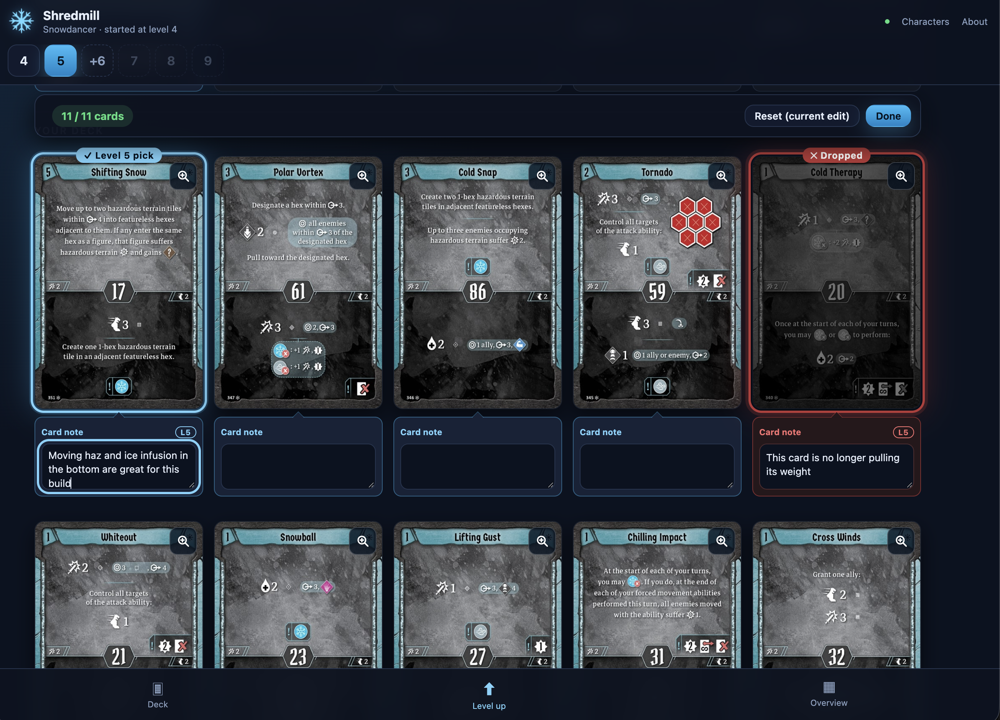

# Frosthaven Deck Builder

A local, single-user deck planning app for all 17 Frosthaven characters and
the Gloomhaven Mercenary Pack classes: Anaphi, Cassandra, Hail, and Satha.
Choose a character to create or reopen its builds.



## Run locally

With Node 22 and [just](https://just.systems/) installed
([full setup](docs/setup.md)):

```sh
just install
just serve
```

## Documentation

- [Development](docs/development.md)
- [Linux deployment](docs/deployment.md)
- [All guides and references](docs/README.md)

## Attribution

Card artwork, text, and class icons are © Cephalofair Games and are used for
personal, non-commercial purposes. Card data and images are sourced through
[cmlenius/gloomhaven-card-browser](https://github.com/cmlenius/gloomhaven-card-browser).
If Cephalofair Games requests it, the images will be removed or this repository
will be made private.
